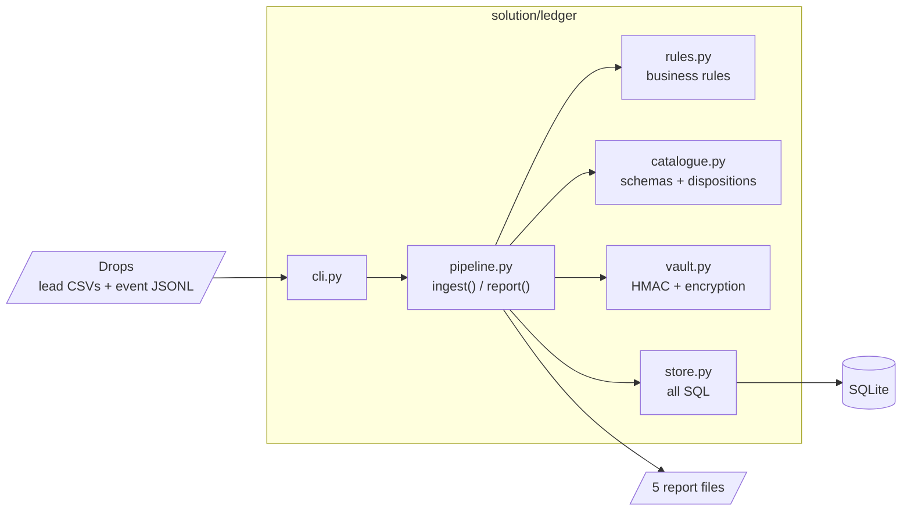

# Submission

## Candidate
- **Name:** Kiran Rajeev
- **Assignment chosen:** A (Data)
- **Time spent (honest estimate):** 6 to 7 Hours

## How to run

Needs Python 3.11 or newer. Run everything from `solution/`. The database, key file, data and reports
it creates are all git-ignored.

```bash
# from the repo root
python3 -m venv .venv && source .venv/bin/activate
pip install -e "solution[dev]"
cd solution

python ../assignment-a-data/tools/generate_data.py --seed 42 --scale small --out data
python -m ledger ingest data/drop_1
python -m ledger ingest data/drop_2
python -m ledger report --out reports

pytest
```

The first `ingest` creates `ledger.db` and a key file next to it, `ledger.db.keys.json`, and prints a
warning about the key file. To start over, delete both files.

Other options:
- `--db PATH` (or the `LEDGER_DB` environment variable) chooses the database.
- `--schemas DIR` chooses the schemas folder.
- `ingest` accepts several drops and processes them in the order given.
- To supply the keys yourself, set `LEDGER_MATCH_KEY` and `LEDGER_ENC_KEY` (Fernet keys) before the
  first run.
- These variables can also go in an optional `solution/.env`, which is read automatically. Copy it
  from `solution/.env.example`.
- Exit codes: `0` success, `1` bad data, `2` bad arguments.

## Design



`ingest` validates lead rows and writes leads and rejections. It appends events to a ledger, all in one
transaction. `report` reads the database as it stands and writes the five files. All business rules
live in `rules.py` as pure functions, so changing a rule means changing one function and its table of
tests. `store.py` is the only file with SQL.

### Schema

| Table | What it holds |
|---|---|
| `leads` | One row per lead, keyed by `(workflow_id, phone_hmac)`. Holds the encrypted phone and name, the last 4 digits, `external_ref`, `batch_id`, and the other fields as JSON. Updated in place when a duplicate merges. |
| `events` | The ledger. One row per unique `event_id`, with the timestamp in UTC plus the original text. The phone is stored only as an HMAC. Triggers block `UPDATE` and `DELETE`. |
| `rejections` | Workflow, batch, row number and reason. No row content, because rejected rows can hold PII. |
| `ingested_files` | The SHA-256 and per-file counters of every file ingested. |
| `dispositions` | The disposition catalogue, reloaded on every ingest. |
| `schema_meta` | The schema version and fingerprints of the two keys. |

All tables are SQLite `STRICT` tables ([ADR-0001](docs/adr/0001-sqlite-strict-tables.md)). SQLite needs
no setup and still gives transactions, constraints and triggers.

### Main ideas

**The ledger only grows. Leads change.**
([ADR-0006](docs/adr/0006-mutable-leads-append-only-ledger.md)) The spec defines a lead as the latest
merge of its rows, so `leads` holds current state. Events are history, so the database itself refuses
any edit or delete on them.

**Events are linked to leads when the report runs, not at ingest.**
([ADR-0002](docs/adr/0002-link-events-at-report-time.md)) The ledger has no `lead_id`. `report` joins
events to leads on workflow and phone HMAC. If an event arrives before its lead, it simply counts once
the lead exists. Nothing has to be re-linked, and ingesting drop by drop gives the same reports as
ingesting everything at once. The cost is that every report recomputes everything: about 9 s at large
scale.

**SQL joins, Python decides.**
([ADR-0007](docs/adr/0007-sql-links-python-owns-rules.md)) SQL returns one row per counted call with
its disposition events. Python then works out each call's effective disposition, and each lead's
bucket, success and the daily numbers.

**Phones are matched with a keyed hash and also stored encrypted.**
([ADR-0003](docs/adr/0003-pii-hmac-match-fernet-store.md),
[ADR-0004](docs/adr/0004-key-resolution-env-then-keyfile.md)) A plain SHA-256 of a phone number is
easy to reverse, since India has only about 4 billion mobile numbers. So matching uses
`HMAC-SHA256(match_key, phone)`. The full phone and name are also stored encrypted under a second key,
so a dialler could still use the data. The masked phone in reports comes from the stored last 4 digits.
The database records each key's fingerprint, and the pipeline refuses to run with a different key.
Without that check, a wrong key would quietly turn every earlier event into an orphan.

**A file is identified by a hash of its contents.**
([ADR-0005](docs/adr/0005-idempotency-by-file-content-hash.md)) A file whose hash is already recorded
is skipped, even under a new name or path. So re-running a drop changes nothing, including the counts
of merges and duplicates.

## Decisions & assumptions

The six bigger decisions are described above and in [`docs/adr/`](docs/adr/). These are the smaller
calls I made where the spec was silent or ambiguous:

| Decision | Why | Alternative |
|---|---|---|
| Two headers that map to the same field fail the whole ingest. | Guessing could corrupt a batch silently. | Use the leftmost column. |
| A file with no column for a required field rejects every row as `missing_required:<field>`. | The spec already has this per-row rule. | Reject the file. |
| A required field that is present but invalid, and is not a phone, is rejected as `invalid:<field>`. No provided schema has such a field. | The spec only names `missing_required` and `invalid_phone`. | Call it `missing_required`. |
| Amounts accept commas only between digits, so both `1,234,567` and `1,23,456` work. They are stored as exact 2-decimal strings. | Rejects junk like `1,,000` without rejecting Indian grouping, and avoids float rounding. | Strip all commas; store floats. |
| An event with a bad timestamp, unknown type, or missing `call_id` or `workflow_id` is malformed. It is not stored and does not reserve its `event_id`. | The ledger keeps only events that can be reported on. | Store it as an orphan. |
| An event with an invalid phone or an unknown workflow is stored and counted as an orphan. | Calls to rejected leads should still show up in data quality. | Count it as malformed. |
| Timestamps must be whole seconds, in `Z`, `+HH:MM` or naive (read as IST) form. Anything else is malformed. | All the generated data fits this. Guessing at other forms could reorder events. | Accept any ISO 8601. |
| Digits must be ASCII `0-9`. | Python's `int()` also accepts other Unicode digits. | Accept them. |
| A call belongs to the lead of its `call.initiated` event. A call without one counts for nothing. | The lead who was called owns the call, and no call is counted twice. | Group by lead and `call_id`. |
| An override, which has no phone, links through its `call_id` to that call's lead, even across drops. | Late corrections still apply. | Treat every override as linked. |
| `disposition_code` is copied into its own column at ingest. | Report SQL then needs no JSON functions. | `json_extract` at report time. |
| Ties go to the larger `event_id`, then the larger `call_id`. The lead report breaks ties by `batch_id`, then masked phone, then creation order. | The output depends only on the data, never on ingest order. | Arrival order. |
| Defaults such as language `en` are applied when leads are read, not stored. | Keeps "the client said en" apart from "we assumed en". | Store the default. |
| Rounding is half-up on exact decimals: 4 places for rates, 2 for amounts. | What a person reading the report expects (`5/160` gives `0.0313`). | Python float formatting. |
| `rejections_by_reason` lists only reasons that occurred. | No made-up zero keys. | List every reason. |
| A duplicate `event_id` with different content is dropped without comparing it. The first copy wins. | The spec says an id already seen is a duplicate. | Compare and flag. |
| Blank event lines are not counted in `events_total`. | The spec counts non-empty lines. | Count them. |
| A lead folder with no matching schema fails the ingest, even if the folder is empty. | Never guess a schema. | Skip the folder. |
| The disposition catalogue is reloaded on every ingest, and `report` uses the stored copy. | `report` takes no schemas folder. | Keep a version of the catalogue per drop. |
| CSVs are read as `utf-8-sig` with `csv.reader`. | Tolerates a BOM. `DictReader` would hide duplicate headers. | `DictReader`. |
| For the stretch goal, I chose performance at large scale. | It fits the design. SQL aggregation would have moved the rules out of Python. | Aggregate in SQL, or report incrementally. |

## Failure modes

**Handled**
- **Running a drop twice.** Every file is skipped and the reports stay identical byte for byte.
- **A crash or error during ingest.** The whole run is one transaction, so nothing is half-written.
  Re-run it.
- **A crash during report.** The files are written to a staging folder first, so the previous reports
  survive.
- **Malformed input.** Bad lines are counted and skipped, and bad rows are rejected with a reason. A
  header clash or an unknown workflow folder stops the ingest with a clear message.
- **Duplicates.** Duplicate events are dropped across drops. Duplicate leads are merged.
- **A batch name reused with different content.** The ingest is refused.
- **Key mix-ups.** A missing key file, an invalid key or a different key is refused, and the error
  names the key.
- **Attempts to rewrite history.** The database blocks edits and deletes on the ledger.

**Not handled**
- **Key rotation.** Changing keys means rebuilding the database from the drops.
- **Two ingests at once.** The second one waits 5 seconds, then fails with a raw "database is locked"
  traceback. Nothing is corrupted, but the message is unfriendly.
- **Duplicate events with different content.** These are not detected.
- **Report files are replaced one at a time.** A crash between two renames could leave a mix of old
  and new files.
- **Changes to the disposition catalogue.** A changed catalogue re-labels past calls.
- **Lead history.** There is no record of which batch changed which field.

## Testing

`pytest` runs 60 tests (135 cases, counting each table row) in about 4 seconds. There is one test
per rule and one per edge case in the assignment. The tests check only what a user can see: report
contents, counts, exit codes and database refusals. They never check internal SQL, so the store can be
rewritten without breaking them.

1. **Rules** (`test_rules.py`): one table per rule, with one row per distinct behaviour. For example,
   the six phone formats and each kind of bad phone, rejection order, effective disposition, and each
   bucket.
2. **Scenarios**: small drops built inside each test, one case per test. Examples: an event before
   its lead, an override arriving a drop late, a header clash rolling back, a key mismatch refused, and
   a crash halfway through an ingest.
3. **Properties on realistic data** (`test_properties.py`): the provided generator makes the input for
   seeds 42 and 2026. It tests the pipeline, not the generator. For each seed:
   - re-ingesting changes no byte of the reports
   - drop-by-drop gives the same reports as all-at-once
   - the counters add up
   - no phone number or name appears anywhere in the database file or the reports
   - the files follow the output contract
4. **CLI** (`test_cli.py`): runs the real command and checks the exit codes and output.

**What the tests can't catch:** a misreading of the spec that I applied consistently. There was no
expected output to compare against. The two rules most likely to differ from yours are half-up rounding
of `connectivity_rate` and how overrides are linked.

## Results

### What the data showed (seed 42, small)

2,057 lead rows: 108 rejected, 57 merged, 1,892 leads. 8,745 event lines: 8 malformed,
237 duplicates, 462 orphans.

- **Many events arrive before their lead.** After drop 1 there are 1,123 orphans; drop 2's leads bring
  this down to 462. Linking only at ingest would have lost those calls.
- **Duplicates cross drops.** 38 event ids appear in both drops, so deduplicating per file would not
  be enough.
- **Timestamps come in three forms.** About a fifth have no timezone at all, so sorting the raw text
  would order events wrongly.
- **Drop 2 renames and reorders every column** (`Mobile No`, `Insured Name`, ...). Values such as
  `Hindi`, where the schema expects `hi`, become field warnings rather than rejections.
- **Calls tail off.** Each workflow has 75 to 140 calls a day until 10 October, then single digits. The
  connectivity rates on those last days (`1.0000` from a single call) are correct but not meaningful.

### Performance at large scale (target: under 2 minutes)

About 144,000 lead rows and 633,000 event lines. Each step was timed as a separate process with
`python bench.py`:

| Run | ingest drop 1 | ingest drop 2 | report | total |
|---|---|---|---|---|
| 1 | 8.95 s | 8.27 s | 8.79 s | **26.0 s** |
| 2 | 9.00 s | 8.22 s | 8.97 s | **26.2 s** |
| 3 | 9.28 s | 8.95 s | 8.93 s | **27.2 s** |

Measured on an i7-13700HX laptop with 16 GB RAM and an NVMe SSD, running Python 3.13 and SQLite 3.53.

That is about 4.5 times faster than the target, and I made no optimisations. I profiled first, and
nothing stood out:
- **Inserts.** These already run inside one transaction, so there is no per-row commit to remove.
- **Ingest time.** Most of it goes on parsing events (JSON, timestamps, phones) and on encryption.
- **Report queries.** These use the indexes, with no full scans inside loops.

## If I had another day

1. **Replace all five reports in one step.** Write each run to its own folder and switch a symlink, so
   no one ever reads a mix of old and new files.
2. **Give a clean error for concurrent ingest** instead of a traceback.
3. **Detect duplicate events with different content.** Store a hash of each event's content and log
   any mismatch.
4. **Add a `rekey` command** for key rotation.
5. **Write up how this would run at 100,000 leads a day:** incremental reports, Postgres, and one
   database per client.
